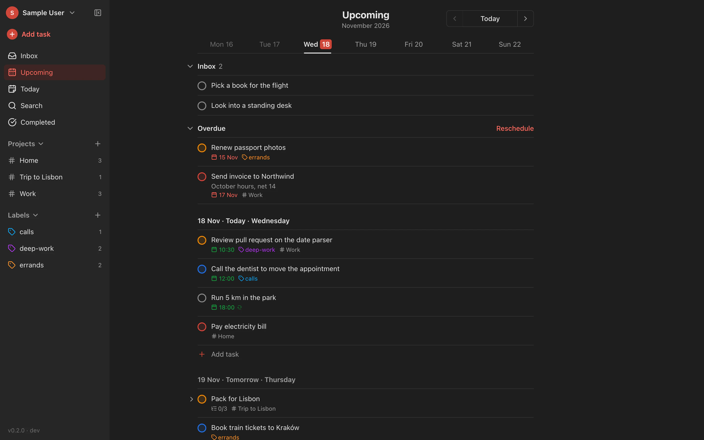

# Soonlane

Soonlane is a free, open source personal task list that opens on Upcoming, laying out your days in one scrolling list. Sign in to use Inbox, Upcoming and Today, organize tasks with labels, projects and subtasks, run the Todoist import, or open the Mac app. It leaves out filters, reporting and sharing. See [PRODUCT.md](PRODUCT.md).

Production: the app at https://app.soonlane.com, the landing at https://soonlane.com



<!-- Demo video: paste its github.com/user-attachments URL here, on a line of its own, so GitHub shows the player. -->

## Self-hosting

Soonlane runs Postgres, the API, and the web app on your server with Docker Compose. One Caddy proxy serves them on a single address. The images come from GHCR (`ghcr.io/mnigos/soonlane-api` and `ghcr.io/mnigos/soonlane-web`, for `linux/amd64` and `linux/arm64`). The API applies database migrations each time it starts. You need Docker with Compose 2.23 or newer.

Sign-in is Google only for now, so every instance needs its own Google OAuth client. Email sign-in is planned.

1. Create a Google OAuth client in Google Cloud Console (APIs & Services, Credentials, Create credentials, OAuth client ID, type Web application). Add `<SOONLANE_URL>/api/auth/callback/google` as an authorized redirect URI, such as `https://tasks.example.com/api/auth/callback/google`, or `http://localhost:8080/api/auth/callback/google` to test on your own machine.
2. Download the Compose file and the example settings into an empty folder.

   ```sh
   mkdir soonlane && cd soonlane
   curl -fsSLO https://raw.githubusercontent.com/Mnigos/soonlane/main/self-host/compose.yaml
   curl -fsSL https://raw.githubusercontent.com/Mnigos/soonlane/main/self-host/.env.example -o .env
   ```

3. Fill in `.env` using the table below, then start the stack.

   ```sh
   docker compose up -d
   ```

4. Open `SOONLANE_URL` and sign in with Google.

| Variable                                     | Required | What it is                                                                                                                                 |
| -------------------------------------------- | -------- | ------------------------------------------------------------------------------------------------------------------------------------------ |
| `SOONLANE_URL`                               | yes      | The public URL without a trailing slash. Defaults to `http://localhost:8080`.                                                              |
| `POSTGRES_PASSWORD`                          | yes      | The database password. Use letters and digits only because it goes straight into the database URL.                                         |
| `AUTH_SECRET`                                | yes      | Signs sessions. Must be at least 32 characters. Generate it with `openssl rand -hex 32`.                                                   |
| `API_PROXY_SECRET`                           | yes      | Lets the web server pass the visitor's IP address to the API. Generate it the same way.                                                    |
| `GOOGLE_CLIENT_ID`, `GOOGLE_CLIENT_SECRET`   | yes      | The Google OAuth client from step 1.                                                                                                       |
| `ALLOWED_EMAILS`                             | no       | Comma-separated addresses allowed to sign up. If unset, any Google account can sign up. Set your own address to keep the instance private. |
| `SOONLANE_LISTEN`                            | no       | Host address where the proxy listens. Defaults to `127.0.0.1:8080`. Set `0.0.0.0:8080` to expose it on your network.                       |
| `SOONLANE_VERSION`                           | no       | The image tag. Defaults to `latest` for the newest release. Use a version like `0.3.0`, or `main` for the latest commit.                   |
| `TODOIST_CLIENT_ID`, `TODOIST_CLIENT_SECRET` | no       | Set both or neither. Configures a Todoist app for Import from Todoist with the redirect URI `<SOONLANE_URL>/api/auth/callback/todoist`.    |

The API checks its settings on startup. If a variable is missing or malformed, the API stops and names it in the logs (`docker compose logs api`).

Google accepts a plain `http` redirect only for `localhost`. For any other address, put HTTPS in front of `SOONLANE_LISTEN`. Use a reverse proxy (Caddy, nginx, or Traefik) or a tunnel like Cloudflare Tunnel. The bundled proxy does not trust forwarded headers. Behind your own proxy, every visitor counts as that proxy's address for the sign-in rate limits.

To update, run `docker compose pull && docker compose up -d`. Data stays in the `postgres-data` volume, and `docker compose down -v` deletes it. A self-hosted instance sends nothing to PostHog. Links to the privacy policy, terms, and changelog still point to soonlane.com.

## Monorepo

| Directory                   | Purpose and main technology                                                                  |
| --------------------------- | -------------------------------------------------------------------------------------------- |
| `apps/web`                  | The web app: TanStack Start (React 19, Router, Query), oRPC v2, Tailwind 4, as a Bun server. |
| `apps/landing`              | The landing: TanStack Start prerendered to static files, served by Caddy.                    |
| `apps/api`                  | API on Railway: a Bun server on Effect 4 ([docs/deploy-railway.md](docs/deploy-railway.md)). |
| `apps/desktop`              | macOS app: an Electrobun window that loads the web app.                                      |
| `packages/contracts`        | oRPC contract and Zod schemas shared by server and browser.                                  |
| `packages/domain`           | Branded types and their Zod schemas, such as `CalendarDate`.                                 |
| `packages/db`               | Drizzle schema, migrations and the migrator for Postgres.                                    |
| `packages/auth`             | Better Auth factory (Google, open sign-up, OAuth proxy) and the browser auth client.         |
| `packages/ui`               | Shared React primitives (`button`, `dialog`, `popover`, `menu`, `sidebar`, …) and `cn`.      |
| `tooling/typescript-config` | tsconfig presets every workspace extends.                                                    |
| `tooling/tailwind-config`   | Tailwind 4 theme and the dark design tokens.                                                 |
| `tooling/vite-config`       | The build info (environment, version, commit) both Vite configs inline.                      |
| `tooling/oxlint-plugin`     | `soonlane/*` lint rules for file names, spec pairing, hooks, repositories and style.         |

Layout, package layering, request flow and the server boundary: [ARCHITECTURE.md](ARCHITECTURE.md). Product and design: [PRODUCT.md](PRODUCT.md), [DESIGN.md](DESIGN.md). Rules for file names, layering and tests: [AGENTS.md](AGENTS.md) and [apps/web/AGENTS.md](apps/web/AGENTS.md).

## Getting started

Prerequisites: Bun **1.4.2** (pinned by `packageManager`). Node is not needed: `bunfig.toml` runs every script and tool under Bun, including the Vite build.

```sh
bun install
cp apps/web/.env.example apps/web/.env.local   # fill it in, and apps/api/.env.local (docs/deploy-railway.md)
bun run db:migrate
bun run dev
```

The app runs at **http://localhost:3000** (the port is fixed; Google OAuth expects it), the landing at http://localhost:3001 and the API at http://localhost:4000.

## Scripts

Run with `bun run <script>` from the root.

| Script                | Purpose                                                                                                                                                        |
| --------------------- | -------------------------------------------------------------------------------------------------------------------------------------------------------------- |
| `dev`                 | The app on port 3000, the landing on 3001 and the API on 4000.                                                                                                 |
| `build`               | Production build: the web server in `apps/web/.output` and the static landing in `apps/landing/dist/client`, each checked after the build, and the API bundle. |
| `typecheck`           | TypeScript in every package.                                                                                                                                   |
| `check` / `check:fix` | oxlint and oxfmt through Ultracite.                                                                                                                            |
| `commit`              | Commitizen prompt for a conventional commit.                                                                                                                   |
| `db:generate`         | Drizzle migration from `packages/db/schema`.                                                                                                                   |
| `db:migrate`          | Apply migrations to the database in `apps/api/.env.local`.                                                                                                     |

## Desktop

`apps/desktop` is an Electrobun app on its own bundled UI (ADR 0015): `bun run view` builds the page from `@soonlane/app` with Vite into `dist/view`, which the app serves as `views://app`. The build bakes in `APP_URL` (the web app, where the browser signs in), `API_URL` and `LANDING_URL` (the landing, for the release notes). From `apps/desktop`: `bun run dev` builds the page and opens the app against the dev servers on ports 3000 and 4000, `APP_URL=https://app.soonlane.com API_URL=https://api.soonlane.com LANDING_URL=https://soonlane.com bun run package` builds the unsigned `.app` and `.dmg` into `build/` and `artifacts/` (it refuses to run without all three), and `bun run sdk` downloads the Electrobun toolchain and SDK (needed once before `bun run check`). Sign-in returns to the app through a loopback port, so it works from any folder.

## Contributing

How to run Soonlane locally, the checks a pull request must pass and the commit rules: [CONTRIBUTING.md](CONTRIBUTING.md).

## Commits

Conventional commits. `bun install` sets up husky: `pre-commit` runs `lint-staged` (Ultracite on staged files), `commit-msg` runs `commitlint`; CI runs `commitlint` on every pull request.

## Reviews

On your own open pull request, comment `/approve` or `/request-changes` on a line of its own (in the Conversation tab or as a Comment review); the Owner Review Commands workflow submits that review for the current head, and new commits dismiss its approval.

## Releases

Versions and the changelog come from release pull requests, and GitHub Releases from the release workflow; see [docs/release.md](docs/release.md).

## Blog

Posts are MDX files published by merging to `main`; see [docs/blog.md](docs/blog.md).

## Deploy

Railway: the landing and the API run as two services in Amsterdam, production from `main` after CI, staging on demand. Details: [docs/deploy-railway.md](docs/deploy-railway.md).

## License

Copyright (C) 2026 Igor Makowski. Soonlane is free software under the [GNU Affero General Public License v3.0 only](LICENSE) (`AGPL-3.0-only`): you may use, change and share it, and if you run a modified version as a network service, you must offer its source to its users.
